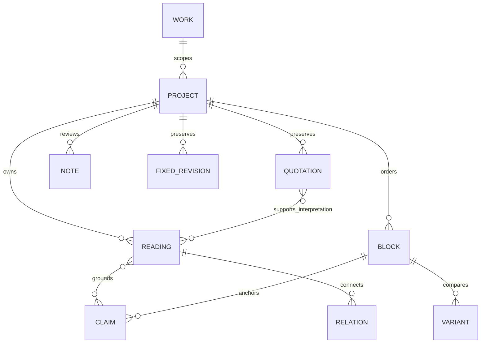

# 领域与本体设计

## 专业聚合

Quotation固定引文、Reading解释方案、Relation论证关系、Block评论段落、Claim文章锚点、Variant段落备选、Note固定意见。根字段：evidence、readings、relations、blocks、claims、variants、notes、basis_refs。专业对象以WorkRef＋owner_plugin_id＋object_id确定身份，revision＋sha256固定内容。相同标题不代表同一对象。

引文固定来源修订及UTF-8字节区间，只追加不可覆盖；原作与二手评论分别标记。每个解释保留适用范围、引文和推理理由。关系区分支持、质疑和限定，允许多种解释共存，不把图可达性、支持数量或循环当逻辑真理。文章主张固定段落摘要、准确选区和所用解释组合摘要；段落、相关解释或关系变化后待复核，旧锚点绝不定位到新稿。新建或主动调整锚点必须匹配当前原文和依据；已有过期记录可保留历史。局部备选固定整个段落摘要，应用后旧主张与意见过期，其他段落字节保持。

所有集合ID唯一、所有引用存在、集合有界、顺序在对应父级唯一。撤销先处理依赖，不能制造悬空引用；来源索引只追加，整本保存不能改变原索引意义。跨包引用只携带固定Owner、对象、修订与摘要，通过公开SDK回读，不导入对方私有结构。

## 权属

原始资料、作品身份与受管事务归Core；专业记录归本包；理解、创作与解释归作者选择的外部Agent；表达取舍与定稿归作者。借助欧卡姆原理复用通用事实，只增加本旅程需要的专业状态。
