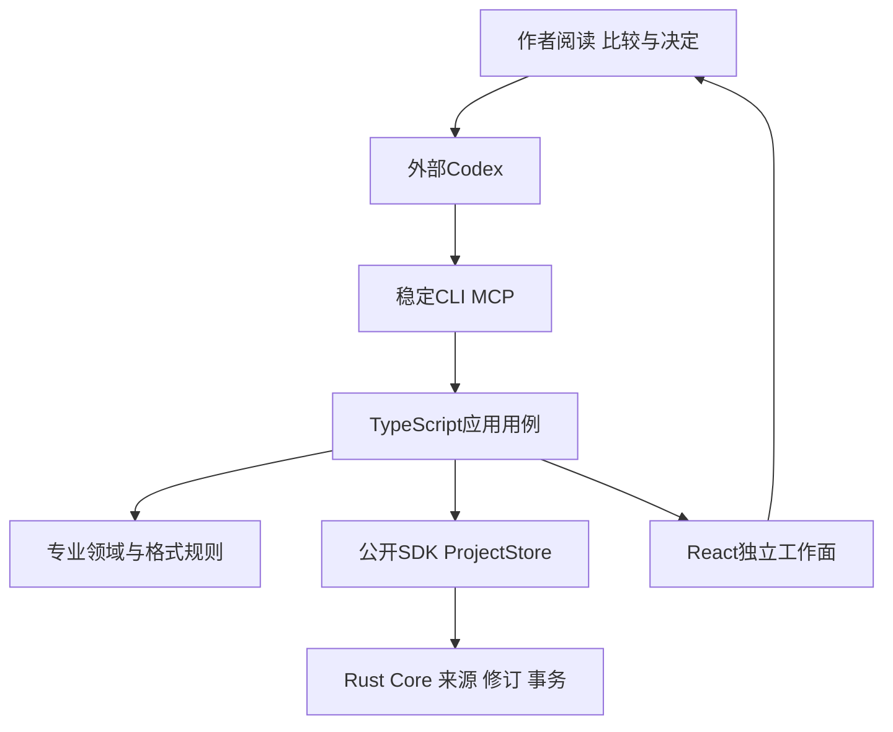

# 架构与技术选型

Recogito区分选择器、目标和批注；W3C区分精确引文与位置选择器。本包借鉴语义分层，不使用DOM字符位置作为持久身份：核心引用固定作品修订及UTF-8字节，评论解释另有理由和适用范围。首版不声称Web Annotation完整导入导出兼容。

DeepSeek Harness与Pi的包、扩展发现、方法资源及生命周期作为生态参考；河图保持外部Agent和创作工程的边界。相同JS／TS栈不代表上游插件可原包运行，不能迁入其模型调度、工具全权或私有存储。宿主Cordis只组合生命周期，插件依赖稳定SDK。

KISS：一个专业聚合、一套公开事务。DRY：来源与修订归Core、字段Schema单一Owner。SOLID：领域、应用、视图和分发单向依赖。YAGNI：只建设本批已明确旅程，不新增模型代理、云平台、数据库或Core作品类型。作者可自由表达，结构只服务持续阅读和返工。
